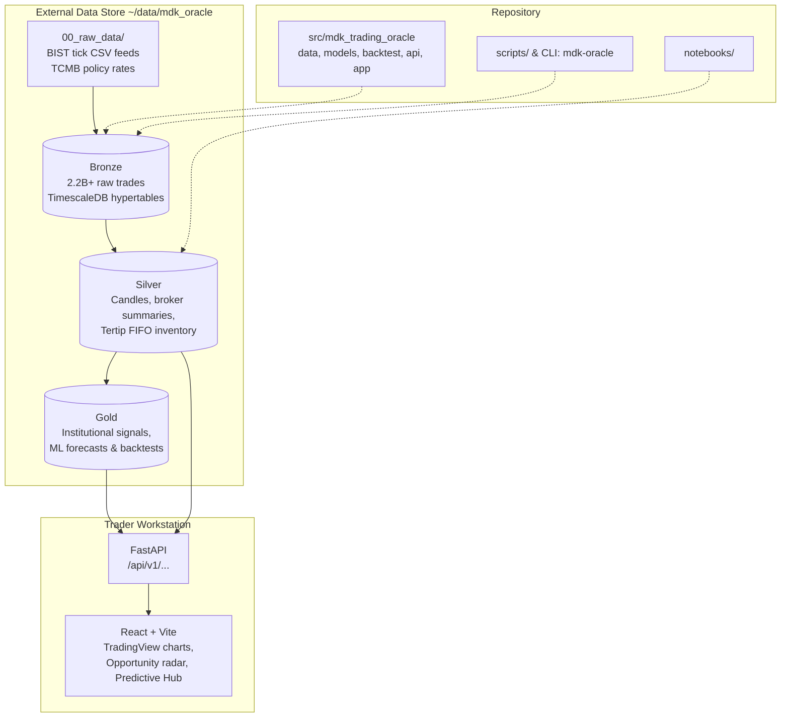

# MDK Trading Oracle

A local-first quantitative decision-support engine and institutional order flow analyzer for **Borsa Istanbul (BIST)**, with specialized intelligence on **Bank of America (BofA / clearing code `MLB`)**.

### Mission
Track and quantify the footprints of market-moving institutions, primarily BofA, to detect accumulation, distribution, aggressive block flows and algorithmic momentum, and translate them into **concrete, high-probability action items and trading signals for individual traders**.

> Contributor and agent rules live in [`AGENTS.md`](AGENTS.md). Domain playbooks live in [`.agents/skills/`](.agents/skills/).

---

## Architecture Overview

The project enforces a strict **separation of code and physical data** and implements a **Medallion Lakehouse** on **PostgreSQL 16 + TimescaleDB + Polars (Python 3.9)**, served to a **FastAPI + React** trader workstation.



### Medallion Lakehouse Layers

1. **Bronze (`bronze_*`)**: Raw, audited ingestion.
   - `bronze_raw_trades`: tick-by-tick executed trades with microsecond timestamps and buyer/seller broker clearing IDs, stored in a compressed TimescaleDB hypertable (2022–2026+, 2.2B+ trades).
   - `bronze_central_bank_rates`: TCMB 1-week repo policy rates (idempotent upserts, forward-filled through market dates).
   - `bronze_bist_index_benchmarks`: official BIST 30 (`XU030`) OHLCV.
   - `bronze_corporate_actions`: splits, rights issues, ticker changes.
   - `bronze_bist30_membership`, `bronze_bist30_changes`, `bronze_bist30_stock_periods`: index membership and rebalancing history.
   - `bronze_instruments`, `bronze_brokers`: dimension tables.
2. **Silver (`silver_*`)**: Cleaned, adjusted and aggregated.
   - `silver_candles_1m` / `5m` / `1d`: continuous aggregates with OHLCV and BofA net turnover for the frontend charts.
   - `silver_daily_broker_summary`, `silver_daily_broker_overview`, `silver_daily_stock_summary`, `silver_daily_sector_summary`: daily turnover, net flow (TL), VWAPs, concentration and adjusted prices/returns.
   - `silver_corporate_action_adjustment_periods`: `quantity_factor` and `canonical_symbol` mappings with turnover conserved.
   - `silver_daily_macro_rates`, `silver_daily_benchmark_index`: rate deltas, carry costs, BIST 30 momentum, volatility and shock regimes.
   - `silver_bofa_historical_flow_thresholds`: empirical P25/P50/P85 flow profiles across 27 scopes (macro + 26 sectors).
   - `silver_intraday_broker_window_summary`, `silver_intraday_sector_window_summary`: 5 intraday windows in Turkish Time.
   - **Tertip FIFO mechanism** (`INTRADAY_MATCHED_FIFO_V1`) for `MLB`, `IYM`, `YKR`, `AKM`, `GRM`, `ZRY`, `TRA`: `silver_broker_fifo_daily`, `_lot_entries`, `_lots`, `_lot_realizations`, `_lot_lifecycle`. See [docs/TERTIP_FIFO_MECHANISM.md](docs/TERTIP_FIFO_MECHANISM.md).
3. **Gold (`gold_*`)**: Signals and predictive intelligence.
   - `gold_institutional_daily_signals`: rolling 5-day / 20-day accumulation metrics and BofA flow Z-scores.
   - `gold_tertip_daily_forecasts`: live T+1 forecasts with target price, expected return, range, stance, playbook, champion model, hit rate and crowned horizon.
   - `gold_tertip_walk_forward_backtests`: audited out-of-sample backtest ledger.

### Intraday Windows (Turkish Time, `Europe/Istanbul`)

| Window | Name | Time |
|---|---|---|
| W1 | Day start | 09:55–10:30 |
| W2 | First reaction | 10:30–11:30 |
| W3 | Midday follow-up | 11:30–14:30 |
| W4 | Afternoon reaction | 14:30–16:00 |
| W5 | Closing session | 16:00–18:15 |

All data, windows, logs and models run strictly in Turkish Time (UTC+3), with no CET or UTC conversions.

---

## Predictive Modeling

The **Tertip ML Forecaster** (`TertipMLForecaster`) turns microstructural order flow into trader decisions:

- **Zero leakage**: features are computed only from prior completed windows / T-1 close.
- **Lean feature set (~21–25)**: Tertip inventory and PnL dynamics, aggregate institutional net flow, execution shares (MLB, BIG5, KAMU), macro rates and carry costs, shock-regime distance, BIST 30 momentum and volatility, a Prophet univariate prior, calendar effects, and flow divergence/rollover features for multi-horizon models.
- **Walk-forward tournament**: BayesianRidge, Huber, LightGBM, XGBoost and Ridge against a Prophet baseline, over 3M / 6M / 12M lookbacks (63 / 126 / 252 sessions).
- **Champion selection**: lowest composite loss
  `(100 - weighted_hit_rate_pct) + 1.0 * hit_mae_pct + 2.5 * miss_mae_pct`,
  with linear recency weighting and hits judged against a ±0.25% deadband. The T+1 champion uses the trailing 30 sessions.
- **Multi-horizon swings (3D, 5D, 10D, 15D, 30D)**: independent direct specialists (no recursive chaining) trained on demeaned targets to remove secular-trend bias.
- **Sample weighting**: quiet days (<1%) 0.75x, significant moves (1–2%) 2.5x, extreme moves (≥2%) 3.0x.
- **Playbooks**: `SQUEEZE_LONG`, `MOMENTUM_EXPANSION`, `BUY ABSORPTION REBOUND`, `STRONG SELL PRESSURE`, `LIQUIDITY_FADE`, `DEFENSE_SUPPORT`, `NEUTRAL_WAIT`.

### Trader Workstation

- **Opportunity Actions** (`OpportunityActionsDashboard.tsx`, `GET /api/v1/tertip/opportunities`): pre-market radar ranking upside and downside opportunities across BIST 30 constituents with conviction tiers.
- **Gold Predictive Hub** (`OracleHubDashboard.tsx`, `GET /api/v1/tertip/ml-forecast`): single-stock deep dive with T+1 signal cards, horizon badges, a 30-day audited ledger and playbooks.
- Candlestick charts with a synchronized BofA net-flow pane (TradingView Lightweight Charts). See [frontend/README.md](frontend/README.md).

---

## Separation of Code & Data

- **Repository**: source code, schemas, ETL scripts, tests, notebooks and `.agents/skills/`. No data is tracked in Git.
- **Data store** (`DATA_DIR`, default `~/data/mdk_oracle/`):

```
~/data/mdk_oracle/
├── 00_raw_data/
│   ├── <year>/<month>/raw_csv/       # Raw BIST tick CSV feeds
│   └── central_bank_interest_rates/  # TCMB repo rate history (.xlsx/.xls/.csv/.parquet)
└── timescale_data/                   # PostgreSQL + TimescaleDB volume (docker-compose)
```

Never hardcode user-specific paths; use `get_settings().data_dir` or `Path.home() / "data" / "mdk_oracle"`.

---

## Quickstart

### 1. Install

```bash
git clone git@github.com:ozy-mdk/mdk-trade-oracle.git
cd mdk-trade-oracle

python3 -m venv .venv
source .venv/bin/activate
pip install -e ".[dev]"

cp .env.example .env   # set DATA_DIR and PG_* settings
```

### 2. Start the database

```bash
docker compose up -d                       # TimescaleDB (PostgreSQL 16)
.venv/bin/python scripts/setup_postgres_lakehouse.py
```

### 3. Run the pipeline

```bash
# Full incremental pipeline (Bronze -> Silver -> Gold), optionally auto-syncing catalogs
.venv/bin/python scripts/run_pipeline.py --target all --sync-catalog

# Gold layer only
.venv/bin/python scripts/run_pipeline.py --target gold

# Reference data loaders
.venv/bin/mdk-oracle load-rates
.venv/bin/mdk-oracle load-corporate-actions
.venv/bin/mdk-oracle load-bist30

# Inspect / sync instrument and broker catalogs
.venv/bin/python scripts/prepare_data_catalog.py          # dry run
.venv/bin/python scripts/prepare_data_catalog.py --sync   # write config/*.yaml
```

### 4. Launch the workstation

```bash
scripts/start_workstation.sh   # TimescaleDB + FastAPI backend + Vite frontend
scripts/stop_workstation.sh
```

---

## Research Notebooks

Launch with `jupyter lab` and select the kernel **`Python 3.9 (mdk-trading-oracle)`**.

1. `00_data_discovery_and_catalog_analysis.ipynb`: raw tick and rate inspection, catalog validation, coverage audits.
2. `01_bronze_data_exploration.ipynb`: tick-level analytics, broker liquidity and execution spreads.
3. `02_silver_transformations_and_intraday_analysis.ipynb`: broker turnover, concentration and 5-window intraday splits.
4. `02b_broker_tertip_fifo_analysis.ipynb`: Tertip FIFO queues, inventory positions and carry PnL decomposition.

---

## Testing & Code Quality

```bash
.venv/bin/pytest
.venv/bin/ruff check .
```

---

## Key Principles

- **Local-first, zero compute cost**: vectorized analytics on local Apple Silicon hardware with Polars and TimescaleDB columnar compression.
- **Strict data isolation**: no exchange data in source control.
- **Concurrent access**: PostgreSQL MVCC lets pipelines (binary `COPY` writes), the API and multiple notebooks read and write simultaneously without file locks.
- **Plan before building**: new models and pipeline changes are planned and agreed before implementation (see `AGENTS.md`).
