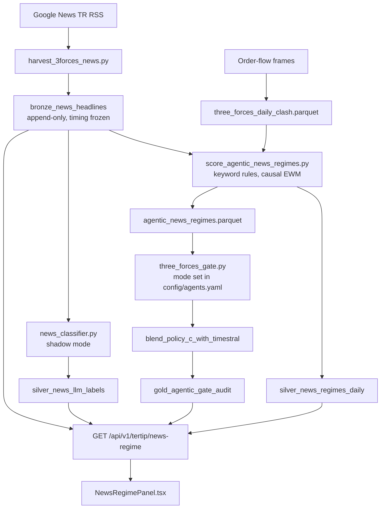

# Three-Forces and News Architecture

Decisions, evidence and how to switch LLM provider are in [AGENTIC_DECISIONS.md](AGENTIC_DECISIONS.md). This document explains how the system works.

## The Three Forces

| Force | Clearing codes | Typical role |
|---|---|---|
| 1. MLB (BofA) | `MLB` | Price-setting institutional flow |
| 2. KAMU (state) | `ZRY`, `VKY`, `HLY` | State-linked support buying in selloffs |
| 3. BIG5 (domestic) | `IYM`, `YKR`, `AKM`, `GRM`, `TRA` | Domestic funds and portfolio managers |

Summing the three into one institutional flow number can hide a conflict: MLB selling into domestic bids looks like net buying. The **passive absorption trap** flags this at the session T close:

```
mlb_5d_share < -0.40%  AND  mlb_10d_share < -0.30%  AND  (kamu_5d + big5_5d) > +0.20%  AND  mlb_cost_spread < -1.0%
```

## Data flow



LLM labels have no path into a forecast.

## Point-in-time rules

- An article with a verified timestamp at or before 18:10 TRT counts for that session. Later ones count for the next session.
- Google News replaces the time of articles older than about 3 days with `07:00:00 GMT` (`10:00:00 TRT`). Those may have appeared after the close, so they always count for the next session.
- Weekend and holiday articles count for the next session in the calendar. Articles after the latest loaded session wait until that session exists.
- News memory uses one-sided EWM with half-lives of 5 and 10 sessions (`adjust=False`), so a value depends only on earlier sessions.
- `verify_zero_leakage` stops scoring if any article's publication time is later than its session's cutoff.

These rules prevent timestamp leakage. They do not remove retrieval bias in `BACKFILL` headlines, which is why evaluation of news value must use `LIVE` headlines (D-007).

## Gate rules (5D, 10D, 15D)

| Mode | Behaviour |
|---|---|
| `off` | Never fires |
| `flow_only` (default) | Order-flow conditions only |
| `flow_news` | Adds keyword news; the bullish rule stays closed if news is missing |

**Bearish:** trap active, `mlb_5d < -3.5`, `mlb_10d < -2.0`, `big5_cost_spread > 5.0`, and `mlb_5d < -5.0` (in `flow_news`, alternatively `fon_krizi_ewm5 >= 0.08` or `bofa_sell_ewm5 >= 0.12`).

**Bullish:** no trap, `mlb_5d > 1.0`, `kamu_5d > 0.5`, `big5_5d > 0.5`, `big5_cost_spread < 2.0` (in `flow_news`, also `fon_krizi_ewm5 < 0.08`).

These rules showed no real lift on stocks outside the 6 they were written on (D-004).

## Commands

```bash
# One-time import of the old parquet, then harvest
PYTHONPATH=. .venv/bin/python scripts/agents/harvest_3forces_news.py --seed-from-parquet

# Daily steps (or install the schedule below)
PYTHONPATH=. .venv/bin/python scripts/agents/harvest_3forces_news.py
PYTHONPATH=. .venv/bin/python scripts/agents/score_agentic_news_regimes.py
.venv/bin/python scripts/agents/label_news_shadow.py --live-only
scripts/agents/install_daily_schedule.sh            # or --remove

# Evaluation
.venv/bin/python scripts/agents/compare_news_labels.py
PYTHONPATH=. .venv/bin/python scripts/experiments/experiment_agentic_3forces_news.py
PYTHONPATH=. .venv/bin/python scripts/experiments/experiment_three_forces_rule_audit.py
```
